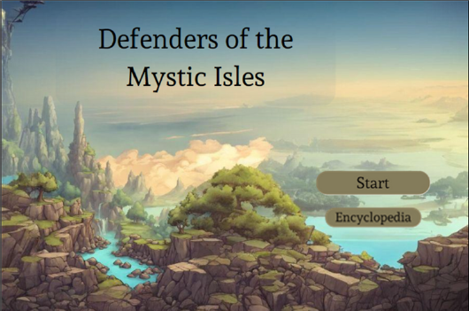
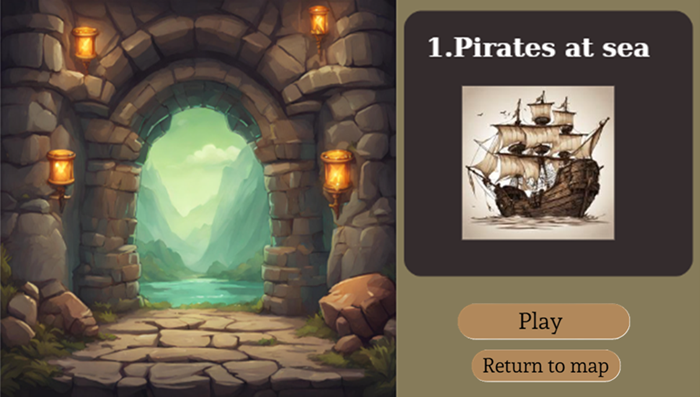
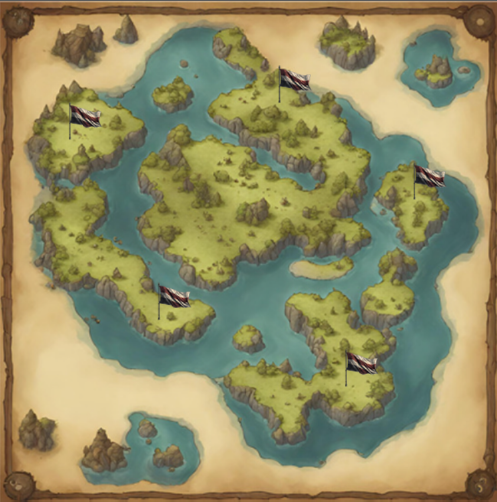

# 🏝️ Defenders of the Mystic Isles

"Defenders of the Mystic Isles" is a tower defense and real-time strategy video game developed in Greenfoot using Java.

The game features a map composed of 5 islands, each representing a distinct level of increasing difficulty. The primary goal is to protect a specific building, known as the Base, from incoming waves of pirates trying to plunder it. If the base survives all enemy waves, the level is won.

## ⚔️ Unique Gameplay Mechanics

While inspired by classic tower defense mechanics, this game introduces unique strategic challenges:
*   **Enemy Pathfinding:** Enemies do not follow a pre-established path. 
*   **Targeting:** Pirates will actively seek out and attack the tower closest to them.
*   **Random Spawns:** Enemies are generated randomly within specific areas of the map, meaning there is no universally valid strategy. 
*   **Real-time Adaptation:** Players do not know exactly where or what type of enemies will appear next, requiring rapid, real-time decision making.

## 💰 Economy & Towers

*   **Starting Funds:** Players start each level with an initial sum of money to build their defenses.
*   **Bounties:** Additional money is earned as a "bounty" every time a tower defeats an enemy. The bounty amount varies depending on the specific type of enemy defeated.
*   **Tower Variety:** Players defend the base by constructing different towers, which vary by their projectile type, attack speed, building cost, and other strategic factors.

## 🗺️ Interface & Navigation

*   **Main Menu:** The starting screen allows players to access the main map via the "Start" button or view game information via the "Encyclopedia" button.
*   **Encyclopedia:** An informative menu detailing the characteristics of different enemies (like the Pirate and Enemy Archer) and towers (like the Archer Tower and Mage Tower) to help players plan their tactics.
*   **Main Map:** A panoramic view of the 5 islands that lets players monitor their completion progress and select the next level or replay previously finished ones.
*   **Pre-Level Screen:** Displays the level's name alongside "Play" and "Return to map" options.

## ⚙️ How to Run the Code

To play this game, you will need the Greenfoot IDE.

1. Download and install [Greenfoot](https://www.greenfoot.org/download) (available for Windows, MacOS, etc.).
2. Clone or download this repository to your computer.
3. Open the downloaded folder and double-click the `project.greenfoot` file.
4. Click the **Run** button at the bottom of the Greenfoot window to start playing.

****

  
  

 

  

